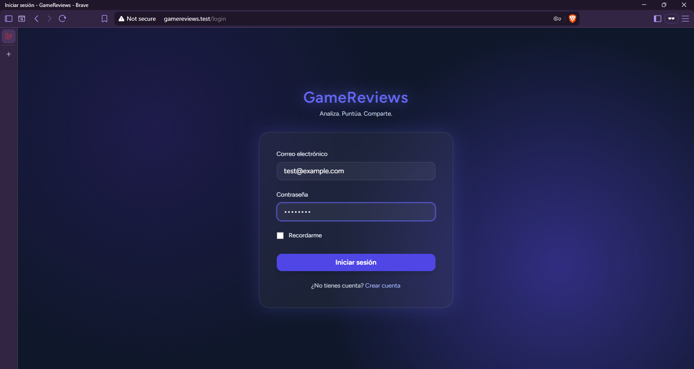
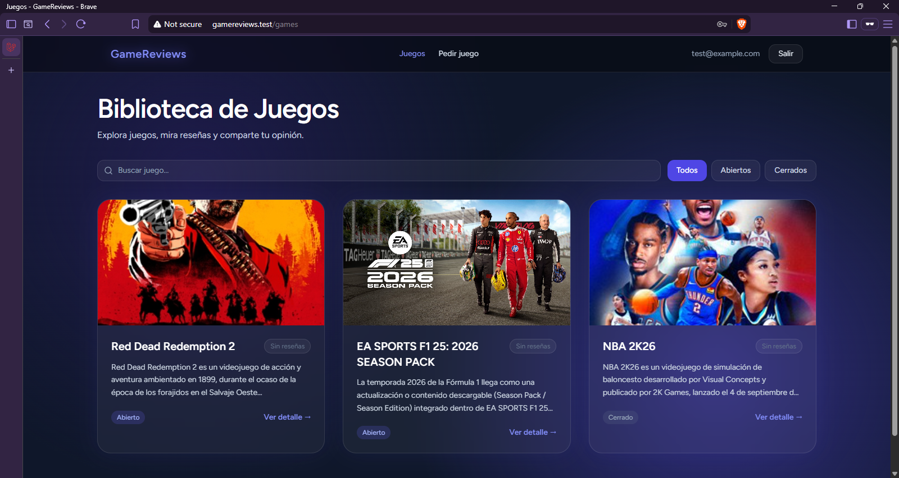
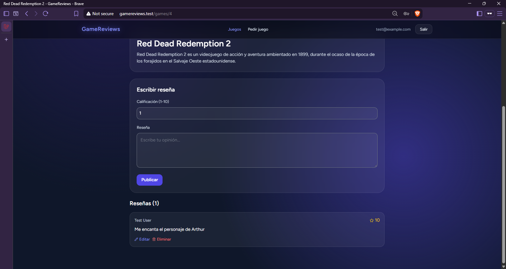
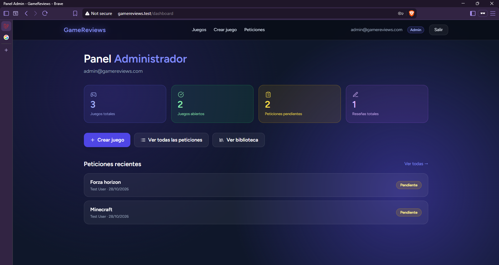
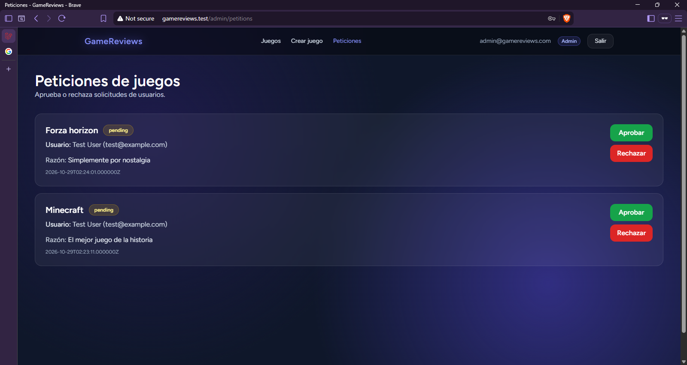

# GameReviews

Plataforma web para publicar y consultar reseñas de videojuegos, con actualizaciones en tiempo real. Los usuarios califican y comentan juegos, y pueden solicitar que se agreguen títulos nuevos; los administradores gestionan el catálogo y aprueban o rechazan esas solicitudes.



## Funcionalidades

**Usuarios**
- Registro, inicio de sesión, verificación de correo y recuperación de contraseña.
- Autenticación de dos factores (2FA).
- Catálogo de juegos abiertos a reseñas.
- Publicar, editar y eliminar reseñas con calificación.
- Las reseñas nuevas o eliminadas aparecen al instante para todos los que están viendo el mismo juego, sin recargar la página.
- Enviar peticiones para agregar un juego que no está en el catálogo.

**Administradores**
- Crear, editar y eliminar juegos, con portada almacenada en Cloudinary.
- Abrir o cerrar un juego a nuevas reseñas.
- Revisar, aprobar o rechazar las peticiones de los usuarios.
- Acceso protegido por roles (middleware `role:admin`).

## Stack

| Capa | Tecnologías |
|---|---|
| Backend | PHP 8.2, Laravel 12, Laravel Fortify, Sanctum |
| Frontend | React, Inertia.js, Tailwind CSS, Radix UI |
| Base de datos | PostgreSQL |
| Tiempo real | Laravel Reverb (WebSockets) + Laravel Echo |
| Almacenamiento | Cloudinary (portadas de juegos) |
| Despliegue | Railway (servicios web, worker de colas, Reverb y PostgreSQL) |

## Capturas

| Catálogo | Detalle y reseñas |
|---|---|
|  |  |

| Panel de administración | Peticiones |
|---|---|
|  |  |

## Cómo funciona el tiempo real

Cuando un usuario publica o elimina una reseña, el `ReviewController` dispara los eventos `ReviewPosted` o `ReviewDeleted`. Ambos implementan `ShouldBroadcast` y se emiten por el canal `game.{id}` a través de Reverb. El frontend escucha ese canal con Laravel Echo y actualiza la lista de reseñas de la página abierta.

## Instalación local

**Requisitos:** PHP 8.2+, Composer, Node.js 20+, PostgreSQL.

```bash
git clone https://github.com/jorgeivanarmendariz1-crypto/GameReviews.git
cd GameReviews

composer install
npm install

cp .env.example .env
php artisan key:generate
```

Configura en `.env` la conexión a PostgreSQL (`DB_*`), las credenciales de Cloudinary (`CLOUDINARY_*`) y las de Reverb (`REVERB_*`). Después:

```bash
php artisan migrate --seed
```

Levanta todos los servicios (servidor, cola, Reverb y Vite) con un solo comando:

```bash
composer run dev
```

> **Windows con Laravel Herd:** si `php artisan serve` falla con `Unable to start curl module`, sirve la app con Herd (`herd link gamereviews`, disponible en `http://gamereviews.test`) y levanta solo los demás servicios:
>
> ```bash
> npx concurrently "php artisan queue:listen --tries=1" "php artisan reverb:start" "npm run dev" --names=queue,reverb,vite
> ```

El seeder crea dos usuarios para pruebas locales:

| Rol | Correo | Contraseña |
|---|---|---|
| Administrador | `admin@gamereviews.com` | `Admin12345*` |
| Usuario | `test@example.com` | `password` |

## Autor

**Jorge Iván Armendáriz Bejarano** — Estudiante de Ingeniería en Sistemas Computacionales, Instituto Tecnológico de Delicias.
[LinkedIn](https://www.linkedin.com/in/jorge-i-armendariz)
